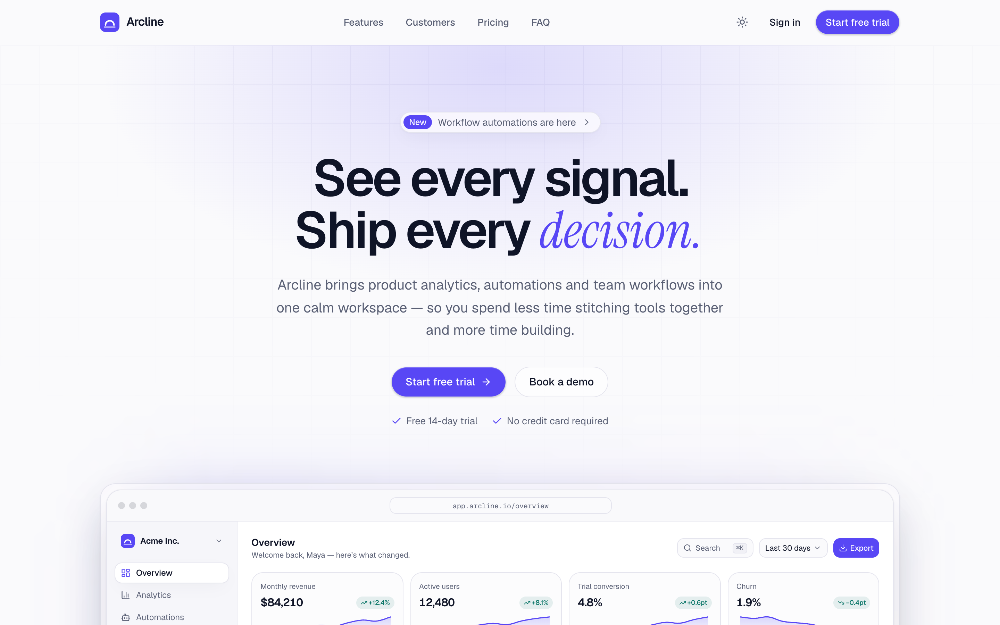
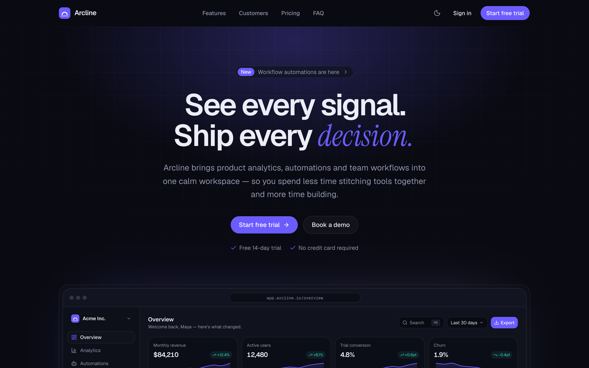

# Arcline Lite: free Next.js SaaS landing page template

A polished, production-ready **SaaS landing page** built with **Next.js 16, React 19, Tailwind CSS 4 and shadcn/ui**. Light and dark themes, fully responsive, accessible, and easy to rebrand. Free under the MIT license.



<details>
<summary>Dark mode</summary>



</details>

> **Want the full template?** [**Arcline Pro**](https://faizancse.gumroad.com/l/arcline) adds 32 more pages: pricing with a comparison table, blog, customer stories, about, contact, 5 auth screens and a 6-screen dashboard. [See the live demo →](https://arcline-omega.vercel.app)

## What's included

- **A complete homepage:** hero with an HTML dashboard mockup, logo strip, feature bento grid, testimonials with stats, pricing cards with a monthly/yearly toggle, FAQ accordion and a closing call-to-action
- **Header and footer:** sticky header with a mobile menu, theme toggle, footer navigation and social links
- **Light & dark themes:** each designed on its own (not just inverted), remembered per visitor
- **Responsive:** checked at 360, 390, 768, 1024 and 1440 px
- **Accessible:** skip link, keyboard-friendly menus, native `<details>` FAQ, reduced-motion support
- **SEO-ready:** metadata, `sitemap.xml`, `robots.txt` and a generated Open Graph image
- **Static by default:** every route prerenders, so hosting is fast and cheap
- **No stock photos:** the mockups are HTML/SVG and follow your brand colors automatically

## Quick start

Requires Node.js 20.9 or newer.

```bash
git clone https://github.com/mohdfaizanahmed/arcline-lite.git my-saas
cd my-saas
npm install
npm run dev
```

Open http://localhost:3000.

## Make it yours

| What | Where |
| --- | --- |
| Name, description, URLs, buttons | `src/config/site.ts` |
| Header and footer links | `src/config/navigation.ts` |
| Pricing plans | `src/config/pricing.ts` |
| All homepage text | `src/data/home.ts` |
| Colors, radius, fonts | `src/app/globals.css` (CSS variables for light and dark) |
| Logo | `src/components/shared/logo.tsx` and `src/app/icon.svg` |

Change `--primary` in `globals.css` and every button, chart line and mockup updates in both themes.

Before you launch:
- Set `NEXT_PUBLIC_SITE_URL` to your domain (on Vercel it's detected automatically).
- Turn off the notice bar: `demo.enabled: false` in `src/config/site.ts`.
- Replace the demo content. Company names, people, testimonials and figures are fictional.
- Point the sign-in, sign-up and contact links in `src/config/site.ts` and `src/config/pricing.ts` to your own app. They currently open the Arcline Pro demo so you can preview those pages.

## Deploy

Push to GitHub and import the repo on [Vercel](https://vercel.com/new). No configuration needed. Any host that runs Next.js works too.

## Tech stack

Next.js 16 (App Router, Cache Components) · React 19 · TypeScript · Tailwind CSS 4 · shadcn/ui on Base UI · Motion · next-themes · Lucide icons

## Lite vs Pro

| | Lite (free) | [Pro](https://faizancse.gumroad.com/l/arcline) |
| --- | :---: | :---: |
| Homepage, header, footer | ✅ | ✅ |
| Light & dark themes, responsive, SEO | ✅ | ✅ |
| Interactive product tour + integrations sections | | ✅ |
| Features, integrations, about, contact, FAQ pages | | ✅ |
| Pricing page with comparison table | | ✅ |
| Blog (index + 6 articles) and customer stories (4 case studies) | | ✅ |
| Auth screens: login, register, forgot/reset password, verify email | | ✅ |
| Dashboard: overview, analytics, projects, team, settings, billing | | ✅ |
| Waitlist page, privacy & terms templates | | ✅ |
| Documentation and email support | | ✅ |
| Pages | 1 | 33 |

The Pro auth screens and dashboard are frontend UI with validation and sample data, ready for you to connect to your own backend (Auth.js, Clerk, Supabase, Stripe…).

**[Get Arcline Pro →](https://faizancse.gumroad.com/l/arcline)**

## License

Arcline Lite is released under the [MIT License](LICENSE): use it for anything, including commercial projects. Fonts and libraries keep their own licenses, see [CREDITS.md](CREDITS.md).

Arcline Pro is a separate product with its own license.
